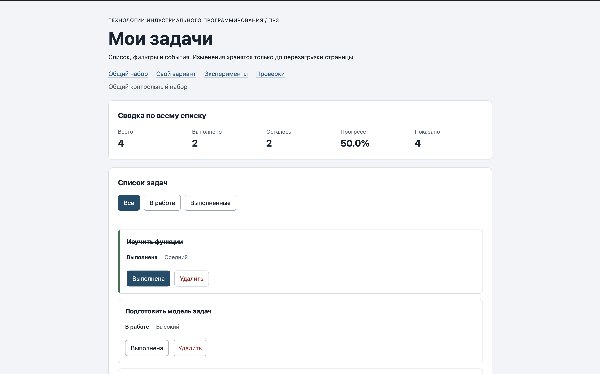

# Отчёт по практической работе № 3

**Тема:** Работа с DOM и событиями

## 1. Автор и окружение

**Имя:** Захаров Артём  
**Группа:** ЭФБО-14-25  
**Вариант:** 4  
**Операционная система:** macOS 26.6.2  
**Node.js:** v24.21.0  
**npm:** 11.19.0  
**Браузер:** Google Chrome 

## 2. Запуск

Рабочая папка: `practice-03` внутри личного репозитория.

```bash
npm run check:service
npm start
```

Установка зависимостей не требуется. Адреса:

```text
http://127.0.0.1:5503/
http://127.0.0.1:5503/index.html?dataset=variant
http://127.0.0.1:5503/examples/dom-events.html
http://127.0.0.1:5503/checks.html
```

Остановка сервера: `Ctrl+C`.

## 3. Что перенесено из ПР2

Файлы `src/task-service.js` и `src/data.js` скопированы без изменений из `practice-02/src/`. Проверка после переноса (`npm run check:service`) прошла 35 из 35 сценариев, ошибок 0. Правки в исходный код ПР2 не вносились.

## 4. Эксперименты

| № | До запуска: прогноз | После запуска: результат | Объяснение |
|---:|---|---|---|
| 1. Отсутствующий элемент и коллекция | 1) `querySelector` → `null`; 2) `querySelectorAll` → `null` (не угадал); 3) `null.textContent = "test"` → ошибка | 1) `null`; 2) `NodeList []` длиной 0; 3) `TypeError: Cannot set properties of null` | `querySelector` возвращает `null` при отсутствии совпадений. `querySelectorAll` всегда возвращает `NodeList`, даже пустой (`length = 0`), а не `null`. Обращение к свойству `null` даёт `TypeError`. |
| 2. `dataset` и числовой id | `dataset.taskId` → `"23"` (строка); `typeof` → `"string"` | `'23'` и `'string'` — прогноз совпал | HTML-атрибуты `data-*` всегда строки, даже если значение выглядит числом. Перед передачей в функции ПР2 нужно преобразовывать через `Number()` и проверять `Number.isSafeInteger()`. |
| 3. Статический NodeList | `items.length` до → 1; после кнопки → 2 (обновится сама) | 1 и 1 (не обновился). Новый `querySelectorAll` → 2 | `querySelectorAll` возвращает статический `NodeList` — снимок DOM на момент вызова. Изменения на странице в нём не отражаются. Нужен повторный вызов. |
| 4. Строка с HTML-разметкой | На странице — текст с угловыми скобками; в Elements — текстовый узел без тега `<strong>`; `textContent` использован ради безопасности | Теги видны как текст, `<strong>` не создан | `textContent` не интерпретирует HTML-разметку, поэтому пользовательский текст безопасен. `innerHTML` выполнил бы любой тег и скрипт внутри строки (XSS), поэтому для названий задач его использовать нельзя. |
| 5. Распространение события | `target` всегда = `lab-label` (реальная цель клика); `currentTarget` меняется; фазы: 1 = capture, 2 = target, 3 = bubble | Строки журнала: `phase=1 target=lab-label currentTarget=lab-card` → `phase=3 currentTarget=lab-button` → `phase=3 currentTarget=lab-card`. `target` во всех строках — `lab-label` | Событие идёт сверху вниз (capture, фаза 1) до реального целевого элемента (target, фаза 2), затем снизу вверх (bubble, фаза 3). `target` — элемент, где реально произошёл клик (не меняется). `currentTarget` — элемент, на котором сейчас работает обработчик (меняется по мере движения). Это основа делегирования. |

## 5. Организация кода

| Файл | Ответственность |
|---|---|
| `src/data.js` | Только данные: общий набор `demoTasks` и набор варианта `variantTasks`. |
| `src/task-service.js` | Прикладные функции ПР2: `createTask`, `findTaskById`, `getTaskStats`, `setTaskCompleted`, `removeTask` и др. Никаких обращений к DOM. |
| `src/task-selectors.js` | `getVisibleTasks(tasks, filter)` — вычисляет выборку по фильтру, не меняя исходный массив. |
| `src/task-view.js` | Создание DOM: `createTaskElement`, `renderTaskList`, `renderSummary`, `renderEmptyState`. Не меняет данные и не навешивает обработчики. |
| `src/main.js` | Состояние (`currentTasks`, `currentFilter`), делегированные обработчики кликов, вызовы сервиса и перерисовка через `renderApp`. |

**Где хранятся данные:** полный массив задач — переменная `currentTasks` в `main.js`; выбранный фильтр — `currentFilter`. Исходные наборы — `demoTasks` и `variantTasks` в `data.js`.

**Где вычисляется сводка:** в `task-service.js` (`getTaskStats` возвращает числа `total`, `completed`, `pending`, `progress`). Отрисовка чисел — в `task-view.js` (`renderSummary`), вызов — из `renderApp` в `main.js`.

**Где обрабатывается событие:** в `main.js`. Две подписки навешаны один раз при запуске: `elements.list.addEventListener("click", handleTaskListClick)` и `elements.filters.addEventListener("click", handleFilterClick)`. Оба обработчика делегированные — клик по любому ребёнку ловится на контейнере.

**Ключевые решения:**
- Названия задач выводятся через `textContent`, а не `innerHTML`.
- Полный массив `currentTasks` не заменяется отфильтрованной выборкой — фильтр влияет только на отображение.
- Идентификатор из `dataset` преобразуется через `Number()` и проверяется `Number.isSafeInteger(id) && id > 0`.
- При ошибке операции (`result.ok === false`) массив не заменяется — состояние сохраняется.

## 6. Общий сценарий

Ожидания по разделу 6.5 методички. Фактические результаты получены при запуске без `?dataset=variant`.

| Шаг | Видимые id | Всего | Выполнено | Осталось | Прогресс | Показано | Сообщение | Совпало |
|---:|---|---:|---:|---:|---:|---:|---|---|
| 0 | [1, 4, 7, 10] | 4 | 2 | 2 | 50.0% | 4 | — | ✅ |
| 1 | [4, 7] | 4 | 2 | 2 | 50.0% | 2 | — | ✅ |
| 2 | [7] | 4 | 3 | 1 | 75.0% | 1 | — | ✅ |
| 3 | [1, 4, 7, 10] | 4 | 3 | 1 | 75.0% | 4 | — | ✅ |
| 4 | [1, 4, 10] | 3 | 3 | 0 | 100.0% | 3 | — | ✅ |
| 5 | [] | 3 | 3 | 0 | 100.0% | 0 | «Нет задач по выбранному фильтру.» | ✅ |
| 6 | [1, 4, 10] | 3 | 2 | 1 | 66.7% | 3 | — | ✅ |
| 7 | [] | 0 | 0 | 0 | 0.0% | 0 | «Список задач пуст.» | ✅ |

**После перезагрузки:** возвращается шаг 0 (Всего 4, Выполнено 2, Прогресс 50.0%). Сохранение между перезагрузками не входит в ПР3 — оно будет в ПР4.

## 7. Индивидуальный вариант

**Тема варианта 4:** «Подготовка семинара».  
**Набор:** `variantTasks` в `src/data.js`. Шесть задач с идентификаторами `[11, 23, 37, 41, 58, 64]`, приоритеты `low`/`medium`/`high`. По таблице варианта 4 изначально выполнены первые три.

| Этап | Всего | Выполнено | Осталось | Прогресс | Видимые id |
|---|---:|---:|---:|---:|---|
| До действий | 6 | 3 | 3 | 50.0% | [11, 23, 37, 41, 58, 64] |
| После переключения id=23 | 6 | 2 | 4 | 33.3% | [11, 23, 37, 41, 58, 64] |
| После удаления id=37 | 5 | 1 | 4 | 20.0% | [11, 23, 41, 58, 64] |
| Итог, фильтр «В работе» | 5 | 1 | 4 | 20.0% | [23, 41, 58, 64] |
| Итог, фильтр «Выполненные» | 5 | 1 | 4 | 20.0% | [11] |

Исходная сводка (до действий) совпала с таблицей варианта 4: 6 / 3 / 3 / 50.0%.

## 8. Протокол проверки сервиса

Вывод `npm run check:service`:

```text
OK: 01. Создание задачи с явным приоритетом
OK: 02. Приоритет по умолчанию
OK: 03. Удаление краевых пробелов без изменения внутренних
OK: 04. Граничные длины названия и положительный безопасный id
OK: 05. Некорректные названия при создании
OK: 06. Некорректные идентификаторы при создании
OK: 07. Все допустимые приоритеты и отклонение недопустимых
OK: 08. Каждый вызов createTask возвращает новый объект
OK: 09. Поиск по id, а не по индексу
OK: 10. Отсутствующая задача и пустой массив при поиске
OK: 11. Поиск не преобразует строковый id в число
OK: 12. Получение невыполненных задач
OK: 13. Пустой список, все выполнены и все не выполнены
OK: 14. Названия в исходном порядке и пустой список
OK: 15. Сводка по общему набору
OK: 16. Сводка по пустому списку
OK: 17. Сводка: ничего не выполнено и выполнено всё
OK: 18. Процент остаётся числом без предварительного округления
OK: 19. Добавление в конец без изменения входного массива
OK: 20. Добавление в пустой список с приоритетом по умолчанию
OK: 21. Повторяющийся id отклоняется
OK: 22. Добавление не обходит проверки createTask
OK: 23. Изменение completed в обе стороны
OK: 24. completed принимает только boolean
OK: 25. Некорректный или отсутствующий id при изменении статуса
OK: 26. Повторная установка статуса создаёт новый результат
OK: 27. Переименование сохраняет остальные поля
OK: 28. Проверки названия при переименовании
OK: 29. Некорректный или отсутствующий id при переименовании
OK: 30. Удаление по id с сохранением порядка
OK: 31. Удаление единственной записи
OK: 32. Некорректный, отсутствующий id и удаление из пустого списка
OK: 33. Входные объекты не изменяются ни одной операцией
OK: 34. Общий сценарий и все промежуточные сводки
OK: 35. Работа с другим набором, без зависимости от demoTasks

Проверок пройдено: 35; не пройдено: 0.
```

## 9. Протокол браузерных проверок

Итог: **36 / 36 пройдено, 0 ошибок**.

## 10. Собственные проверки

| № | Исходное состояние и действия | Ожидание | Факт | Итог |
|---:|---|---|---|---|
| 1 | Фильтр «Все», задача id=1 выполнена. Клик по кнопке «Выполнена» у id=1 один раз. | Задача id=1 становится невыполненной, сводка 4/1/3/25.0%/4 | Совпало | ✅ |
| 2 | Фильтр «Все», задача id=4 невыполнена. Клик по вложенному `<span class="action-label">` внутри кнопки «Выполнена». | Toggle срабатывает, потому что `closest` поднимается до кнопки | Совпало | ✅ |
| 3 | Фильтр «В работе». Быстро переключать «Все» → «В работе» → «Выполненные» 5 раз. | Карточки не дублируются, счётчики не накапливаются, обработчики не «размножаются» | Совпало | ✅ |

Случай 1 — обычное поведение. Случай 2 — граница события (клик по вложенному элементу). Случай 3 — повторная отрисовка.

## 11. Отладка и клавиатура

**Точка останова** поставлена в `main.js` в `handleTaskListClick` на строке чтения `dataset.taskId`. Проверенные значения при клике по кнопке «Выполнена» у задачи id=4:

- `event.target` — `<span class="action-label">` (реальный элемент клика);
- `event.currentTarget` — `<ul id="task-list">` (контейнер с делегированным обработчиком);
- `card.dataset.taskId` — строка `"4"`;
- `id = Number(...)` — число `4`;
- `action` — строка `"toggle"`;
- найденная задача — `{ id: 4, title: "Подготовить модель задач", completed: false, priority: "high" }`;
- `result` сервиса — `{ ok: true, tasks: [...] }` (новый массив);
- `currentTasks` — заменён новым массивом, вызывается `renderApp()`.

**Клавиатура:** переключение статуса и удаление работают с клавиатуры (Tab → Enter/Space). После изменения статуса фокус возвращается на ту же кнопку задачи (через `restoreTaskFocus`). После удаления задачи фокус переходит на активный фильтр.

**Отказ:** через панель Elements временно изменён `data-task-id` карточки на `777` — выведено «Задача не найдена.», данные не изменились. Изменён на `4abc` — выведено «Некорректный идентификатор задачи.», данные не изменились. После выбора фильтра карточки пересозданы из настоящего массива, сообщение очищено.

## 12. Вид приложения



## 13. Дополнительное задание

Дополнительное задание не выполнялось.

## 14. Вывод

В ПР3 данные и прикладные функции ПР2 были соединены с браузерным интерфейсом. Все обязательные задания (§6.1–§6.5) выполнены: проведены пять экспериментов с DOM и событиями, реализованы карточки задач, делегированные обработчики статуса и удаления, три фильтра, сводка и два вида пустого состояния. Пройдены 35 сервисных и 36 браузерных проверок; ручной сценарий §6.5 совпал с ожидаемым на всех восьми шагах.

**Ключевое различие — изменение данных и изменение DOM.** Удаление карточки из `<ul>` через `element.remove()` не удаляет задачу: при следующей перерисовке она появится снова, если массив не изменён. В приложении это реализовано правильно: сначала вызывается `removeTask(currentTasks, id)`, возвращающий новый массив, затем `currentTasks = result.tasks`, и только после этого `renderApp()` пересобирает DOM из актуальных данных. То же касается смены статуса: toggle не меняет текст кнопки напрямую, а вызывает `setTaskCompleted`, и уже новый массив отражается в интерфейсе.

Такой подход — единый источник данных + перерисовка всего представления — тот же шаблон, который используется в React и Vue. Освоив его на чистом DOM, легко понять, зачем нужны эти библиотеки.

Ещё один практический вывод — разделение ответственности по файлам. `task-service.js` не знает о DOM, `task-view.js` не меняет данные, `main.js` только связывает события, сервис и перерисовку. Каждый файл можно менять независимо от других, и это заметно упрощает отладку.

## 15. Самопроверка

- [x] Перенесены проверенные `task-service.js` и `data.js` из ПР2 без правок.
- [x] Пять экспериментов проведены, прогнозы записаны до запуска.
- [x] Карточки создаются DOM-методами, названия — через `textContent`.
- [x] Повторная отрисовка не дублирует карточки; контейнер `<ul>` сохраняется.
- [x] Действия обрабатываются делегированно, включая клики по вложенной подписи.
- [x] Изменение статуса и удаление вызывают функции ПР2.
- [x] Фильтры не уничтожают скрытые записи; активная кнопка согласована.
- [x] Общая сводка и «Показано» рассчитываются по разным наборам.
- [x] Различаются «Список задач пуст.» и «Нет задач по выбранному фильтру.».
- [x] Некорректный и отсутствующий идентификаторы не повреждают данные.
- [x] Общий и индивидуальный сценарии пройдены; проверена клавиатура.
- [x] Получены протоколы 35/0 (сервис) и 36/36 (браузер).
- [x] Добавлены три собственных случая, один из них — граничный.
- [x] Отчёт заполнен фактическими результатами, не ожидаемыми.