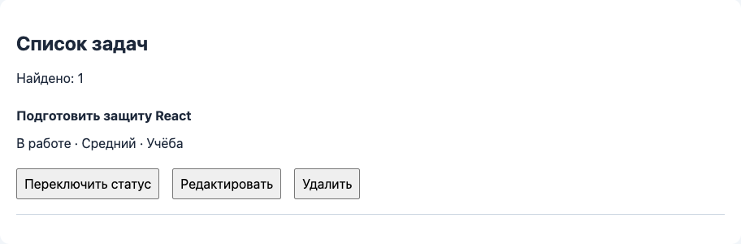

# Практическая работа 7
## Создание компонентного интерфейса на React

**Автор:** Захаров Артём  
**Группа:** ЭФБО-14-25  
**Вариант:** 4  
**Среда:** Node.js 24.21.0, npm 11.19.0; браузерный прогон — Node.js 24.22.1 и Chrome 157.0.8103.51  
**Проверено:** 16 ноября 2026 г. (ночь с 15 на 16 ноября по Москве).

## Постановка задачи

Собрать React-приложение для задач: создание, редактирование, смена статуса, удаление с подтверждением, четыре совместных фильтра и общая статистика. Данные хранятся в памяти страницы.

## Запуск

Из корня личного репозитория:

```bash
cd practice-07
npm ci
npm run dev
```

Открыть http://127.0.0.1:5173/. Остановка — Ctrl+C. Если порт занят: `npm run dev -- --port 5177`. Проверки: `npm test`. Сборка: `npm run build`, просмотр: `npm run preview` (обычно http://127.0.0.1:4173/). Не открывать index.html двойным щелчком.

## Компоненты и состояние

App хранит tasks, filters, editingId и сообщение результата. TaskForm хранит draft и errors, проверяет поля и вызывает синхронный onSave. TaskFilters передаёт новый объект фильтров. TaskList показывает количество найденных и карточки TaskItem. TaskStats получает статистику полного массива. Данные идут вниз через props, действия — вверх через обработчики.

visibleTasks, stats и editingTask вычисляются при рендере, поэтому отдельных состояний для них нет. Добавление использует spread, редактирование и переключение — map с новым объектом, удаление — filter. Аргументы не изменяются. Следующий id вычисляется по полному previous внутри функционального обновления. confirm вызывается перед setTasks.

Карточка имеет key=task.id. У формы key=editingId ?? 'new': выбор другой задачи пересоздаёт её локальный черновик. Ошибки связаны с полями через aria-describedby и aria-invalid. При неверном вводе или onSave=false значения остаются в форме.

## Индивидуальный вариант

Начальный фильтр — priority=medium. Ожидалось: создание записи среднего приоритета увеличит число карточек на одну. Фактически: создана «Подготовить защиту React» с id 35; найдено 4 → 5, всего 12 → 13. После дополнительного поиска показана созданная карточка.



## Проверки

`npm test`: **28 успешно, 0 ошибок**. `npm run build`: сборка успешна. Пример Counter проверен отдельно с шагами 1 и 3: изменение одного счётчика не меняет другой. На основной странице пример отсутствует.

| № и действие | Ожидаемый результат | Фактический результат |
|---|---|---|
| 1. Сбросить фильтры после загрузки | 12 карточек; всего 12, выполнено 5, в работе 7. | 12 карточек, статистика 12 / 5 / 7. |
| 2. Отправить название из пробелов | Ошибка у названия, массив не изменяется, ввод сохраняется. | Пробелы отклонены, черновик сохранён, массив не изменён. |
| 3. Отправить название из 100, затем из 101 символа | Первое принимается, второе отклоняется. | 100 символов приняты, 101 отклонён. |
| 4. Создать «  Новая задача  » | Пробелы убраны, задача в работе, форма очищена. | Название нормализовано, форма очищена. |
| 5. Отредактировать выполненную задачу | Новые поля сохранены, статус остаётся выполненным. | Редактирование сохраняет completed=true. |
| 6. Начать правку A, затем нажать «Редактировать» у B | Форма содержит данные B, черновик A не переносится. | Ключ формы сбросил черновик A при выборе B. |
| 7. Изменить поля и отменить редактирование | Исходная запись не изменена, форма вернулась к созданию. | Отмена сохранила исходную запись. |
| 8. Дважды переключить статус | Статус и статистика вернулись к исходным значениям. | Два переключения вернули исходный статус. |
| 9. Отказаться от удаления, затем подтвердить | После отказа запись остаётся; после подтверждения удаляется. | Отказ сохраняет запись, подтверждение удаляет. |
| 10. Удалить редактируемую запись | Форма переходит в режим создания. | Удаление редактируемой записи вернуло форму создания. |
| 11. Применить все четыре фильтра | Показаны только записи, удовлетворяющие всем условиям. | Четыре условия одновременно выбрали одну задачу. |
| 12. Ввести поиск без совпадений, затем сбросить | Показано пустое состояние, затем восстановлен весь текущий список. | Пустая выборка и сброс фильтров работают. |
| 13. Создать запись, не подходящую под фильтры | Общий счётчик вырос; карточка скрыта до смены фильтра. | Неподходящая запись скрыта, общая статистика увеличилась. |
| 14. Ввести название `` | Отображается буквальный текст, код не исполняется. | HTML отображён текстом, img не создан. |
| 15. Удалить все задачи, затем создать новую | Пустой список и нулевые счётчики; создание продолжает работать. | Удалён весь набор, создание из пустого массива работает. |
| 16. Перезагрузить страницу | Восстановлены исходный набор и начальные фильтры варианта. | Перезагрузка восстановила 12 задач и фильтр среднего приоритета. |
| 17. Пройти форму и кнопки клавиатурой | Видимый фокус, понятные подписи, действия доступны без мыши. | Форма отправлена клавиатурой, фокус виден. |
| 18. Выполнить сценарий варианта в preview | Поведение совпадает с dev-режимом. | В собранном приложении вариант 4: 4 → 5 карточек. |

Браузерные сценарии воспроизведены через Playwright в настоящем Chrome, включая preview. Необработанных ошибок и предупреждений React не обнаружено. Скриншоты и JSON-протокол находятся в `reports/practices-07-09`.

## Контрольные вопросы

1. **Чем JSX отличается от строки HTML?**  
JSX описывает интерфейс внутри JavaScript. При сборке он превращается в вызовы React, а строка HTML остаётся обычным текстом.

2. **Чем props отличаются от состояния?**  
Props приходят от родителя. Состояние компонент хранит сам и меняет через функцию обновления.

3. **Почему изменение обычной переменной не заменяет `useState`?**  
Обычная переменная создаётся заново при вызове компонента и не вызывает перерисовку. useState сохраняет значение между рендерами.

4. **Когда требуется функциональная форма обновления состояния?**  
Функциональное обновление нужно, когда следующий результат зависит от предыдущего: например, при добавлении задачи в массив.

5. **Почему нельзя менять объект задачи внутри поверхностной копии массива?**  
Копия массива содержит ссылки на прежние объекты. Поэтому для изменённой задачи я создаю отдельный объект через spread.

6. **Для чего списку стабильный `key` и почему индекс здесь не подходит?**  
key связывает карточку с конкретной задачей. Индекс после удаления сдвигается, а id остаётся привязанным к записи.

7. **Почему видимая выборка и статистика не хранятся в отдельных состояниях?**  
Список и статистика вычисляются из tasks и filters при рендере. Отдельное состояние для них пришлось бы постоянно синхронизировать.

8. **Как дочерний компонент сообщает родителю о действии?**  
Родитель передаёт обработчик через props. Дочерний компонент вызывает его с id задачи.

9. **Что делает поле управляемым?**  
Управляемое поле получает value из состояния и обновляет это состояние в onChange.

10. **Почему `categoryId` из `select` требует преобразования?**  
select возвращает строку. Я преобразую категорию через Number и проверяю, что такой числовой id есть в справочнике.

11. **Как меняется состояние формы при изменении её ключа?**  
При смене key React создаёт форму заново, поэтому она получает поля выбранной задачи вместо прежнего черновика.

12. **Почему подтверждение удаления не помещается внутрь функции обновления?**  
Функция обновления должна быть чистой. React может вызвать её повторно в StrictMode, поэтому confirm выполняется до setTasks.

13. **Как отличить отсутствие задач от отсутствия совпадений фильтра?**  
При пустом массиве статистика показывает ноль всего. При отсутствии совпадений общий счётчик остаётся больше нуля, а найдено равно нулю.

14. **Что проверяет `npm test` и чего он не проверяет?**  
npm test проверяет чистые предметные функции. Компоненты, внешний вид и действия пользователя я дополнительно проверил в браузере.

15. **Какие части приложения потребуется изменить для подключения API в ПР8?**  
Нужно заменить локальные операции запросами API, добавить эффект загрузки и состояния ожидания и ошибок, а onSave сделать асинхронным.

## Вывод

Я разделил интерфейс на компоненты и связал их состоянием App. При действиях создаются новые массивы и объекты. После перезагрузки исходные 12 задач возвращаются: useState хранит данные только до закрытия текущей страницы. Для работы с сервером в следующей практике нужны запросы и асинхронное сохранение.
