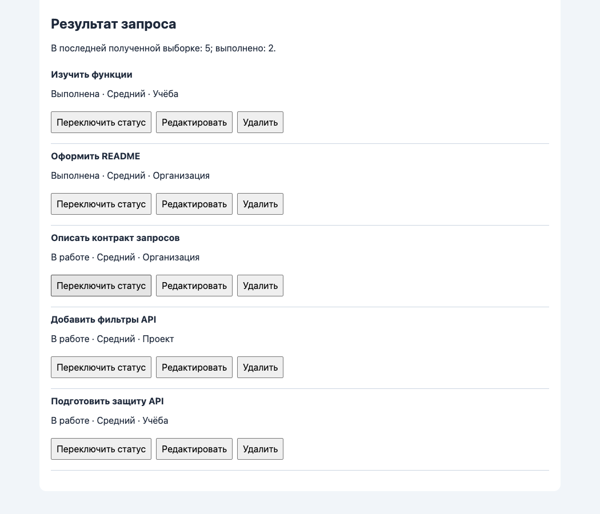
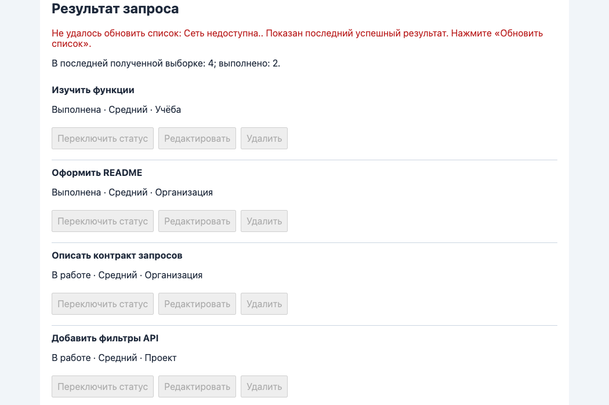

# Практическая работа 8
## Работа React-приложения с API

**Автор:** Захаров Артём  
**Группа:** ЭФБО-14-25  
**Вариант:** 4  
**Среда:** Node.js 24.21.0, npm 11.19.0; браузерный прогон — Node.js 24.22.1 и Chrome 157.0.8103.51  
**Проверено:** 16 ноября 2026 г. (ночь с 15 на 16 ноября по Москве).

## Постановка задачи

Подключить React к учебному API: получать данные при смене фильтров, выполнять CRUD, показывать загрузку и ошибки, сохранять черновик при неуспешной записи и защищаться от устаревших ответов и двойной отправки.

## Запуск

В первом терминале:

```bash
cd practice-08
npm ci
npm run api
```

API: http://127.0.0.1:5505/api, проверка: http://127.0.0.1:5505/api/health.
Во втором терминале из `practice-08`:

```bash
npm run dev -- --port 5174
```

Открыть http://127.0.0.1:5174/. Так ПР7 на 5173 и ПР8 на 5174 могут работать одновременно. Остановка — Ctrl+C в каждом терминале. При занятом порту API: `npm run api -- 5518`, скопировать `.env.example` в `.env`, задать `VITE_API_URL=http://127.0.0.1:5518/api`, затем перезапустить Vite. Сборка: `npm run build`, просмотр: `npm run preview`. API должен работать и при preview.

## Архитектура

Компоненты показывают форму, фильтры и список. App хранит снимок редактируемой записи, фильтры и сообщение. useTaskData управляет запросами; task-api задаёт пути и предметные методы, api-client выполняет fetch и преобразует HTTP-ошибки. Предоставленные HTTP-модули и асинхронная форма сохранены из заготовки, реализован хук и установлен вариант 4.

Эффект зависит от api, q, completed, priority, categoryId, revision. Он вызывает loadInitialData, который получает задачи и категории. В cleanup active становится false, затем вызывается abort. Проверка актуальности есть и в try, и в catch. Старый запрос не заменяет новый результат, даже если API проигнорирует signal. api создан один раз в config.js. snapshot не входит в зависимости.

Отдельный ref хранит текущий контроллер записи и блокирует второй вызов до первого await. Чтение и запись используют разные контроллеры. При размонтировании отменяются оба вида запросов. В finally снимается только собственная блокировка. StrictMode оставлен включённым.

## Загрузка и изменения

snapshot — последний успешный результат. Ошибка GET не очищает его. mutationError относится только к записи. После подтверждённого POST/PATCH/DELETE хук увеличивает revision: эффект повторяет GET с актуальными фильтрами. Ошибка этого GET не отменяет уже подтверждённое сохранение и не вызывает повторный POST.

Форма ожидает Promise<boolean>: при false сохраняет ввод, при true очищается либо выходит из редактирования. При pending или недостоверном результате загрузки изменяющие элементы отключены. Статистика показывает последнюю полученную выборку, а не все задачи сервера.

## Индивидуальный вариант

Начальный фильтр: priority=medium.

| Действие | Метод и путь | Тело | Статус | Фактический результат |
|---|---|---|---|---|
| Исходная выборка | GET /api/tasks?priority=medium | — | 200 | 4 задачи |
| Создание | POST /api/tasks | title: «Подготовить защиту API», priority: medium, categoryId: 1 | 201 | Сервер назначил id 35 и completed=false |
| Повторное чтение | GET /api/tasks?priority=medium | — | 200 | 5 задач, включая новую |

Полное JSON-тело POST: `{"title":"Подготовить защиту API","priority":"medium","categoryId":1}`.
Браузерный прогон использовал отдельные порты 5808 и 5805, preview — 5878. Фактические адреса и статусы сохранены в `reports/practices-07-09/verification.json`.



## Проверки

`npm test`: API **23/0**, интеграция **14/0**, React **15/0**, всего **52/0**. `npm run build`: успешно.

| № и действие | Ожидаемый результат | Фактический результат |
|---|---|---|
| 1. Открыть приложение с работающим API | GET задач и категорий; после сброса фильтров 12 задач. | Получены 12 задач и 3 категории с реального API. |
| 2. Запустить интерфейс при выключенном API | Ошибка загрузки, доступна кнопка обновления. | При остановленном API показана ошибка и кнопка повтора. |
| 3. Включить API и нажать обновление | Получены категории и задачи, ошибка очищена. | После запуска API повтор восстановил задачи и категории. |
| 4. Ввести поиск без совпадений | Успешный GET и сообщение о пустой выборке. | Пустой ответ 200 показан как успешная пустая выборка. |
| 5. Быстро изменить фильтры при throttling | Старые ответы не заменяют результат актуального фильтра. | При задержке сети итог соответствует последнему поиску модель. |
| 6. Отправить пустое название | Ошибка формы, POST отсутствует. | Валидация пробелов остановила отправку POST. |
| 7. Создать задачу и обновить страницу | Задача сохранена, пока работает тот же API. | После перезагрузки созданная запись осталась на сервере. |
| 8. Дважды быстро нажать сохранение при медленной сети | Один POST, одна новая запись. | Две отправки подряд вызвали один POST и одну запись. |
| 9. Редактировать выполненную задачу | PATCH без completed; статус сохраняется. | PATCH формы не содержит completed; выполненный статус сохранён. |
| 10. Переключить статус при активном фильтре | PATCH, затем GET с теми же условиями. | PATCH и GET completed=false скрыли завершённую задачу. |
| 11. Отказаться от удаления, затем подтвердить | При отказе запроса нет; при подтверждении DELETE 204 и новый GET. | Отказ без DELETE; подтверждение DELETE 204 и новый GET. |
| 12. Отключить API перед сохранением заполненной формы | Черновик сохраняется, ошибка изменения показана, блокировка снимается. | При остановленном API черновик сохранён, ошибка показана, блокировка снята. |
| 13. Отключить API после успешной загрузки, нажать обновление | Последний снимок остаётся, видна ошибка обновления, изменения временно отключены. | Ошибка GET сохранила последний снимок и заблокировала изменение. |
| 14. Начать редактирование, затем скрыть запись фильтром | Черновик не теряется; сохранение адресуется исходному id. | Черновик сохранён после скрытия фильтром; PATCH адресован id 1. |
| 15. Ввести название `` | Название отображается буквальным текстом. | Серверное название с HTML отображается буквальным текстом. |
| 16. Перезапустить сервер и обновить список | Возвращается исходный набор. | Перезапуск API вернул исходные 12 задач. |
| 17. Выполнить вариант и базовый CRUD в preview | Поведение соответствует dev-режиму. | Preview: загрузка, создание medium и удаление 204 работают. |

Дополнительно блокировался GET категорий после успешного POST: сообщение об успешной записи осталось, ошибка GET показана отдельно. После снятия блокировки получена ровно одна новая запись. Проверки выполнялись в Chrome через Playwright с настоящим локальным API; задержка и блокировка запросов задавались браузерным инструментом. Необработанных ошибок и предупреждений React нет.



## Контрольные вопросы

1. **Зачем для загрузки данных нужен эффект, а не запрос в теле компонента?**  
Запрос в теле компонента повторялся бы при каждом рендере. Эффект запускает загрузку при изменении нужных зависимостей.

2. **Когда React вызывает cleanup?**  
Cleanup вызывается перед новым запуском эффекта и при удалении компонента. В StrictMode есть дополнительный проверочный цикл.

3. **Почему callback эффекта не объявляется `async`?**  
Эффект должен вернуть функцию очистки, а async возвращает Promise. Поэтому асинхронная загрузка объявлена внутри эффекта.

4. **Какие зависимости нужны загрузке и почему в них нет `snapshot`?**  
Зависимости: api, q, completed, priority, categoryId и revision. snapshot является результатом загрузки и вызвал бы повторяющиеся запросы.

5. **Почему стабильная ссылка на api важна?**  
Если создавать api заново при рендере, его ссылка каждый раз меняется и эффект запускается снова. В config он создаётся один раз.

6. **Зачем кроме AbortController проверять актуальность ответа?**  
Некоторые реализации API могут проигнорировать отмену. Признак active дополнительно запрещает старому ответу менять состояние.

7. **Почему защита от устаревшего результата нужна и в catch?**  
Старая ошибка тоже может прийти позже нового успешного ответа. Проверка в catch не даёт ей испортить актуальный результат.

8. **Что проверяет дополнительный цикл StrictMode?**  
StrictMode проверяет, правильно ли эффект очищает запросы при повторном запуске. Пробный GET отменяется, актуальный завершается.

9. **Почему одной переменной pending в state недостаточно для двух синхронных вызовов?**  
Обновление state применяется после обработки события. Ref меняется сразу и блокирует второй вызов ещё до первого await.

10. **Что означает true, возвращённое saveTask, если повторный GET завершился ошибкой?**  
true означает, что сервер подтвердил изменение. Ошибка последующего GET показывается отдельно и не требует повторять успешный POST.

11. **Почему нельзя автоматически повторять POST после тайм-аута?**  
При тайм-ауте сервер уже мог сохранить запись. Повторный POST может создать дубликат, поэтому сначала нужно обновить список.

12. **Почему смена фильтров не должна отменять мутацию?**  
Фильтр относится к чтению списка. Сохранение должно завершиться независимо от него, а новый GET использует актуальные фильтры.

13. **Что происходит с серверной операцией после отмены клиентского ожидания?**  
Отмена прекращает ожидание клиента. Она не гарантирует отмену изменения, которое сервер уже успел выполнить.

14. **Чем meta.total отличается от общего числа записей на сервере?**  
meta.total показывает число записей в полученной выборке. При активном фильтре это может быть лишь часть задач сервера.

15. **Какие сценарии не проверяются jsdom и требуют браузера?**  
jsdom не подтверждает браузерный CORS, внешний вид, реальные сетевые запросы и удобство работы мышью или клавиатурой.

## Вывод

Я реализовал загрузку через эффект с очисткой и общую функцию изменения данных. Интерфейс согласуется с ответом сервера, а ошибки чтения и записи обрабатываются отдельно. Данные остаются после перезагрузки страницы, пока работает процесс API. Перезапуск API возвращает исходный набор. Собственный API ПР9 пока поддерживает чтение; полный перенос операций записи относится к ПР10.
