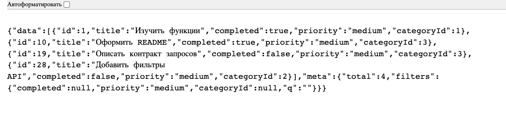
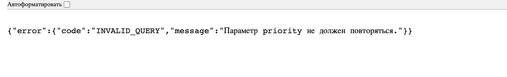

# Практическая работа 9
## Создание собственного HTTP API

**Автор:** Захаров Артём  
**Группа:** ЭФБО-14-25  
**Вариант:** 4  
**Среда:** Node.js 24.21.0, npm 11.19.0; браузерный прогон — Node.js 24.22.1 и Chrome 157.0.8103.51  
**Проверено:** 16 ноября 2026 г. (ночь с 15 на 16 ноября по Москве).

## Постановка задачи

Создать Express API для чтения задач и категорий, совместной фильтрации и единообразной обработки ошибок. Сохранять контракт учебного API в пределах операций чтения.

## Установка и запуск

```bash
cd practice-09
npm ci
npm start -- 5515
```

API: http://127.0.0.1:5515/api. Использован отдельный порт, чтобы одновременно оставить API ПР8 на 5505. Остановка — Ctrl+C. Без аргумента `npm start` использует 5505. Альтернатива: `API_PORT=5515 npm run dev`. Файл .env загружается только явно: `node --env-file=.env src/server.js`.

Проверки: `npm run check:unit`, `npm run check:api`, `npm test`. Тесты сами выделяют свободный порт. Express 5.1.0 и остальные зависимости зафиксированы lock-файлом.

## Реализация

validation.js проверяет id и query; task-service.js отбирает задачи и ищет запись по id; store.js предоставляет копии исходного набора; routes.js формирует ответы; app.js подключает заголовки, OPTIONS, Router, 404 и обработчик ошибок; server.js открывает порт. Инфраструктура app, store, errors и server предоставлена, реализованы validation, task-service и routes.

parsePositiveId проверяет всю строку по /^[1-9]\d*$/ и Number.isSafeInteger. parseFilters сначала проверяет имена и getAll(name).length, затем значения. Поэтому одинаковые повторения тоже отклоняются. Строка false преобразуется через raw === 'true' после проверки допустимых значений. Фильтры объединяются через И, исходный массив не меняется.

## Контракт

GET /api/health возвращает статус ok; GET /api/categories — категории и total; GET /api/tasks — задачи, total и нормализованные filters; GET /api/tasks/:id — отдельную запись. HEAD возвращает такие же заголовки без тела; OPTIONS — 204. Изменяющие методы на известных путях получают 405 с Allow: GET, HEAD, OPTIONS.

Успех: `{"data":{"status":"ok"}}`.
Ошибки: `{"error":{"code":"INVALID_ID","message":"Некорректный идентификатор задачи."}}` (400); `{"error":{"code":"TASK_NOT_FOUND","message":"Задача не найдена.","details":{"id":2}}}` (404); METHOD_NOT_ALLOWED (405). Неизвестный путь: ROUTE_NOT_FOUND (404), неожиданное исключение: INTERNAL_ERROR (500), без стека.

meta.total — размер выборки. Пустой список получает 200, отсутствующая отдельная запись — 404. В ПР9 операции записи и debug/reset отсутствуют по методичке; они относятся к ПР10.

## Индивидуальный вариант

Фактические полные URL приведены с портом изолированного прогона 5809. При ручном запуске выше заменить его на 5515.

| Запрос | Ожидаемые статус и данные | Фактический результат |
|---|---|---|
| http://127.0.0.1:5809/api/tasks?priority=medium | 200; id 1, 10, 19, 28 | 200; те же id, total 4 |
| http://127.0.0.1:5809/api/tasks?priority=medium&priority=medium | 400 INVALID_QUERY | 400 INVALID_QUERY; повтор запрещён |
| http://127.0.0.1:5809/api/tasks/1 | 200; задача из выборки | 200; id 1, «Изучить функции», completed=true, priority=medium, categoryId=1 |
| http://127.0.0.1:5809/api/tasks/2 | 404 TASK_NOT_FOUND | 404; details.id=2 |

Полные тела и заголовки ответов сохранены в `reports/practices-07-09/verification.json`.





## Автоматические проверки

`npm test`: **90 успешно, 0 ошибок** — 38 модульных и 52 HTTP. Ожидаемые значения тестов сохранены. Они проверяют в том числе 500 с подставным хранилищем и отсутствие служебных сведений в ответе.

## Протокол HTTP-запросов

| № и действие | Ожидаемый результат | Фактический результат |
|---|---|---|
| 1. GET health | 200, статус `ok`. | 200, data.status = ok. |
| 2. GET categories | 200, три категории. | 200, 3 категории. |
| 3. GET tasks | 200, 12 задач, фильтры по умолчанию. | 200, total 12, фильтры null/null/null/пустая строка. |
| 4. Запрос своего варианта | id и total соответствуют таблице. | 200, id [1, 10, 19, 28], total 4. |
| 5. Поиск без совпадений | 200, пустой массив, total 0. | 200, data [], total 0. |
| 6. GET tasks/4 | Именно задача с id 4. | 200, data.id = 4. |
| 7. GET tasks/2 и tasks/4abc | Соответственно 404 и 400, разные коды. | 404 TASK_NOT_FOUND и 400 INVALID_ID. |
| 8. Неизвестный и повторяющийся query | 400 INVALID_QUERY. | Оба запроса: 400 INVALID_QUERY. |
| 9. POST tasks | 405, Allow; число задач не меняется. | 405, Allow: GET, HEAD, OPTIONS; следующий GET по-прежнему вернул 12 задач. |
| 10. GET неизвестного пути | 404 ROUTE_NOT_FOUND в JSON. | 404 ROUTE_NOT_FOUND, JSON. |
| 11. HEAD tasks | 200, JSON-заголовки, без тела. | 200, application/json; тело отсутствует. |
| 12. OPTIONS tasks | 204, CORS, без тела. | 204, CORS-заголовки; тело отсутствует. |
| 13. Остановить и запустить сервер заново | Исходные данные доступны снова. | Процесс перезапущен, GET вернул исходные 12 задач. |

Все 13 сценариев воспроизведены отдельными HTTP-запросами. Дополнительно выполнен fetch из браузерной страницы другого origin: ответ со средним приоритетом доступен и содержит 4 записи; CORS работает. Чтение именно из интерфейса ПР8 не выполнялось, полный CRUD через собственный сервер в ПР9 не требуется. Пример books.js отдельно вернул 200 для /books/3 и 404 для /books/9 и был остановлен.

## Исправленная незавершённость заготовки

Симптом: GET /categories в стартовом routes.js вызывает notImplemented и возвращает 501. Причина: вместо обработчика данных оставлена заглушка. Исправление: получить категории из store и вернуть JSON с meta.total. Итоговая HTTP-проверка получила 200 и три категории. Остальные заглушки задания тоже заменены реализацией; рабочих ответов 501 больше нет.

## Контрольные вопросы

1. **Чем JavaScript в Node.js отличается от JavaScript в браузере?**  
Node.js запускает JavaScript вне браузера и предоставляет серверные API. В нём нет DOM, window и localStorage.

2. **Что определяет выбор маршрута: путь, query или HTTP-метод?**  
Маршрут выбирается по HTTP-методу и пути. Query передаёт параметры выбранному обработчику.

3. **Чем `req.params` отличается от query-параметров?**  
req.params содержит части пути, например id после /tasks/. Query содержит значения после вопросительного знака, например priority=medium.

4. **Почему строка `'false'` требует явного преобразования?**  
Boolean('false') даёт true, потому что строка непустая. После проверки допустимых строк я использую raw === 'true'.

5. **Зачем проверять весь id и `Number.isSafeInteger`?**  
Проверка всей строки отклоняет 4abc и 01. Number.isSafeInteger не позволяет принять число, которое JavaScript не представляет точно.

6. **Почему пустая выборка имеет статус 200, а отсутствующая задача — 404?**  
Пустой список является успешным результатом фильтрации. Код 404 нужен, когда запрошенной отдельной задачи не существует.

7. **В чём различие `TASK_NOT_FOUND` и `ROUTE_NOT_FOUND`?**  
TASK_NOT_FOUND означает отсутствие задачи по правильному id. ROUTE_NOT_FOUND означает, что такого пути API нет.

8. **Чем 405 отличается от 404 и зачем нужен Allow?**  
При 405 путь известен, но метод запрещён. Allow перечисляет разрешённые методы; при 404 сам ресурс или маршрут отсутствует.

9. **Что означает `meta.total` при активных фильтрах?**  
Это количество записей после фильтрации. Для priority=medium в исходном наборе total равен четырём.

10. **Как порядок middleware влияет на результат?**  
Middleware выполняются по очереди. Сначала идут заголовки и OPTIONS, затем маршруты, обработчики 405, общий 404 и обработчик ошибок.

11. **Почему обработчик ошибок имеет четыре параметра?**  
Express распознаёт обработчик ошибок по сигнатуре из четырёх параметров: error, req, res, next.

12. **Зачем фабрика приложения отделена от открытия порта?**  
createApp можно импортировать в тесты без открытия порта. Каждый тест запускает независимый экземпляр на свободном порту.

13. **Какие данные допустимо отправлять клиенту при внутренней ошибке?**  
Клиент получает общий код INTERNAL_ERROR и понятное сообщение. Стек, пути файлов и внутренние данные остаются на сервере.

14. **Почему CORS не является авторизацией?**  
CORS регулирует доступ браузерного кода к ответу. Он не проверяет личность пользователя и не ограничивает прямые HTTP-запросы.

15. **Какие изменения потребуются в ПР10 для подключения всех действий клиента ПР8?**  
Нужно добавить POST, PATCH и DELETE, проверку JSON и полей, создание id и операции записи в хранилище. Затем можно подключить весь клиент.

## Вывод

Я реализовал собственный сервер Express с проверкой внешнего ввода и понятными HTTP-ошибками. Разделение модулей позволяет проверять логику отдельно от маршрутов. Все операции чтения сохраняют исходные данные. Создание, изменение и удаление потребуют расширения сервера в следующей практике.
